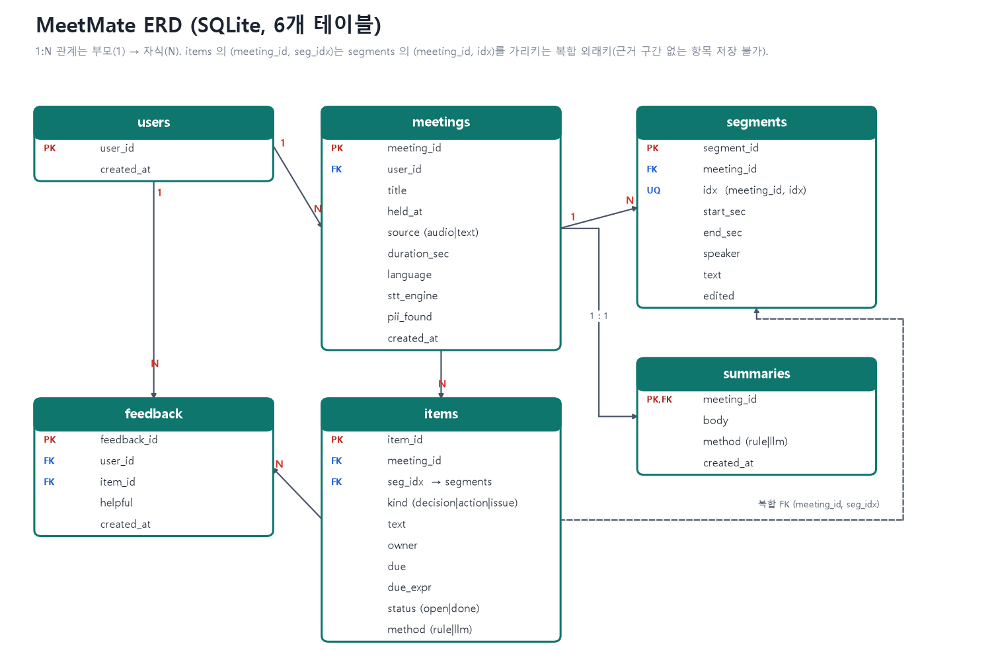
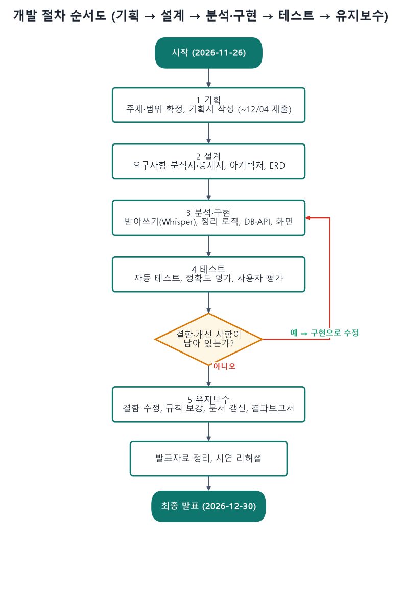
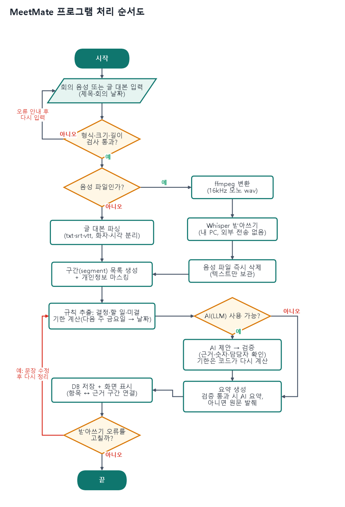

# MeetMate 프로젝트 기획서

작성일 2026-11-26 · 작성자 반재영 · 제출 2026-12-04 · 최종 발표 2026-12-30 · 과정: 인공지능 응용 시스템 개발 종합 프로젝트

## 1. 프로젝트 개요

| 항목 | 내용 |
|---|---|
| 프로젝트명 | MeetMate — 로컬 음성 받아쓰기 기반 회의 정리 시스템 |
| 한 줄 소개 | 회의 녹음을 **내 PC에서** 받아쓰고, **결정 사항·할 일(담당자·기한)·미결 사항·요약**을 원문 근거와 함께 정리합니다. AI가 지어낸 항목은 검증으로 걸러냅니다. |
| 핵심 기술 | 음성 인식(faster-whisper) · 규칙 기반 한국어 정보 추출 · 로컬 LLM(Ollama) + 검증 · BM25 검색 · Node.js 24 · SQLite |
| 개발 형태 | 개인 프로젝트(1인), 외부 npm 패키지 0개 |

## 2. 개발 배경과 목적

### 2.1 문제
1. **회의 후 정리의 부담**: 회의가 끝나면 누군가 기억으로 정리하거나 아예 하지 않아 "그때 뭘 하기로 했지?"가 반복됩니다. 특히 팀 프로젝트(본인 경험: 의견 충돌·일정 변경·팀원 이탈)에서 합의 내용이 남지 않았습니다.
2. **개인정보·보안 부담**: 클라우드 받아쓰기·요약 서비스는 회의 음성을 외부 서버로 보내야 하고 비용이 듭니다.
3. **AI 요약의 신뢰 문제**: 생성형 AI는 없는 결정, 틀린 날짜, 틀린 담당자를 그럴듯하게 만듭니다. 회의록은 "누가 언제까지"가 틀리면 쓸모가 없습니다.
4. **받아쓰기 오류**: 음성 인식은 고유명사를 자주 틀리므로 사용자가 고칠 수 있어야 합니다.

### 2.2 목표
- 음성을 PC 밖으로 보내지 않고, 처리 후 음성 파일은 삭제한다.
- 모든 결정·할 일에 **근거 발언(구간·시각)** 을 붙여, 사용자가 AI의 정리를 바로 검증하게 한다.
- AI의 지어내기를 **구조적으로 차단**한다(근거 구간 필수, 문장 일치, 새 숫자 금지, 기한은 코드가 계산).
- LLM·Whisper가 없어도 글 대본 정리는 항상 동작한다.
- 측정한 정확도와 한계를 **있는 그대로** 문서화한다(가상 데이터는 가상이라고 표시).

## 3. 사용자와 시나리오

| 사용자 | 상황 | MeetMate 사용 |
|---|---|---|
| 팀 프로젝트·스터디 구성원 | 회의 후 합의 내용·역할이 흐려짐 | 녹음 업로드 → 결정·할 일·미결 확인 → 할 일 모아보기 |
| 소규모 팀 리더 | 회의록 작성에 시간이 듦 | 요약·할 일 확인, 받아쓰기 오류만 고치고 내려받기 |
| 개인정보가 든 회의 | 외부 전송 불가 | 로컬 처리, 음성 즉시 삭제, 마스킹 저장 |

**시나리오**: 주간 회의 녹음을 올린다 → "받아쓰기 중 → 정리 중" 진행 표시 → 결정 2건·할 일 3건(기한은 회의 날짜 기준 실제 날짜)·미결 2건이 나온다 → 할 일을 누르면 근거 발언으로 이동 → "배포"가 "폐포"로 잘못 받아써진 것을 고치고 "다시 정리" → 완료한 일은 체크, 남은 일은 "할 일 모아보기"에서 확인.

## 4. 주요 기능

| 구분 | 기능 | 설명 |
|---|---|---|
| 입력 | 음성·글 대본 | wav·mp3·m4a·ogg·flac·webm(내용으로 형식 판별), 브라우저 녹음, txt·SRT·VTT |
| 받아쓰기 | 로컬 Whisper | ffmpeg 변환 → faster-whisper(small), 구간·시각, 처리 후 음성 삭제 |
| 정리 | 결정·할 일·미결 | 규칙(정밀) + AI 제안(재현율 보완) + 검증(환각 차단), 담당자·기한 추출 |
| 날짜 | 기한 계산 | "다음 주 금요일까지" → 회의 날짜 기준 실제 날짜(코드로 계산) |
| 요약 | 요약 | 기본은 원문 발췌, AI 요약은 검증 통과 시에만(화면에 구분) |
| 근거 | 근거 구간 연결 | 항목 클릭 → 원문 구간·시각으로 이동, 근거 없는 항목은 DB에 저장 불가 |
| 교정 | 교정·다시 정리 | 틀린 받아쓰기를 고치고 다시 정리, 완료 상태 유지 |
| 관리 | 할 일·검색·내보내기 | 완료 체크·담당자·기한 수정, 전 회의 할 일 모아보기, 원문 검색, 회의록(.md) |
| 개인정보 | 마스킹·삭제 | 전화·이메일 등 마스킹 저장, 회의 삭제, 「내 기록 모두 삭제」 |

## 5. 시스템 설계 개요

### 5.1 아키텍처

```
브라우저(public/)  ──HTTP──▶  http.mjs  ──▶  app.mjs(작업 큐·업무 흐름)
  업로드·녹음·결과·교정        검증·제한·보안헤더      │
                                                  ├─ stt.mjs ─▶ ffmpeg ─▶ transcribe.py(faster-whisper)  ※자식 프로세스
                                                  ├─ transcript.mjs  구간 만들기·마스킹
                                                  ├─ extract.mjs     규칙 추출 + AI 제안·검증 + 요약
                                                  ├─ dates.mjs       기한 → 날짜 계산
                                                  ├─ llm.mjs         Ollama / Claude / ChatGPT 어댑터
                                                  ├─ search.mjs      BM25 회의 검색
                                                  └─ db.mjs          SQLite 6개 테이블
```

- **http 층**: 본문 크기 제한(413), 사용자별 호출 간격(429), 경로 이탈 차단, CSP 헤더, 오류는 일반 문구만 노출.
- **app 층**: 요청은 즉시 jobId를 반환하고, 무거운 처리는 **한 번에 하나씩** 큐에서 실행(Whisper가 CPU를 거의 다 쓰므로).
- **stt 층**: 셸 없이 인자 배열로 실행(명령 주입 방지), 서버가 만든 난수 파일명만 사용, 음성은 `finally`에서 삭제.

### 5.2 정리(추출) 파이프라인 — 규칙 + AI + 검증

1. **규칙 경로**: 한국어 회의 말투 패턴으로 문장을 분류한다. 예) 결정 "~하기로 했습니다", 할 일 "OO 님이 ~까지 ~해 주세요"·"제가 ~까지 ~하겠습니다", 미결 "아직 정해지지 않았습니다"·"논의가 필요합니다". 진행 멘트("공유하겠습니다", "마치겠습니다")는 제외한다. **원문 문장을 그대로 쓰므로 지어낼 수 없다.**
2. **AI 제안**: 로컬 LLM이 규칙이 놓친 구간을 제안한다(번호가 붙은 대본을 JSON으로 답하게 함).
3. **검증 관문**(통과한 것만 채택):
   - 근거 구간이 실제로 존재하는가
   - 항목 문장이 근거 구간과 충분히 겹치는가(글자 쌍 50% 이상)
   - 항목의 숫자가 근거 구간에도 있는가("3일"→"30일" 변조 차단)
   - 담당자가 참석자 이름과 일치하는가(모르는 이름은 버림)
   - **단서 관문**: 문장이 그 종류에 맞는 말투 단서를 가졌는가(잡담을 할 일로 분류하는 것 차단), 단서가 다르면 재분류
   - 기한은 AI 값을 쓰지 않고 근거 문장에서 코드가 다시 계산
4. **요약**: 기본은 중요 문장 발췌(추출식). AI 요약은 새 숫자 금지·대본 어휘 60% 이상일 때만 사용.
5. 규칙이 이미 분류한 구간은 AI가 다른 종류로 덮어쓰지 못하며, AI가 실패하면 규칙 결과만 남는다.

### 5.3 날짜 계산
"내일·모레·이번 주 금요일·다음 주 월요일·12월 5일·이번 주 안으로·이번 달 말"을 회의 날짜(Date.UTC 기반, 시간대 오류 없음)로 계산한다. '까지·중으로·안으로' 같은 마감 표지가 있을 때만 기한으로 인정해 "오늘 회의는 여기까지"를 기한으로 오인하지 않는다.

### 5.4 데이터 설계
테이블 6개: users, meetings, segments, summaries, items, feedback. `items(meeting_id, seg_idx)`가 `segments(meeting_id, idx)`를 가리키는 **복합 외래키**라 근거 없는 항목은 저장 자체가 거부된다. 모든 데이터는 사용자 삭제 시 연쇄 삭제된다.



### 5.5 API
`POST /api/meetings/text|audio`(→ jobId), `GET /api/jobs/status`, `GET /api/meetings`·`/get`·`/export`, `POST /api/segments/edit`·`/api/meetings/reextract`·`/api/items/update`·`/api/meetings/delete`·`/api/forget`, `GET /api/actions`·`/api/search`·`/api/status`·`/api/stats` (상세는 요구사항 명세서 3장).

### 5.6 개발 절차 순서도



### 5.7 프로그램 처리 순서도



## 6. 활용 기술과 선택 이유

| 기술 | 선택 이유 |
|---|---|
| faster-whisper(small, CPU int8) | 한국어 인식이 가능한 오픈 모델, 로컬 실행으로 음성이 밖으로 나가지 않음, API 비용 없음. 그래픽카드(GTX 1050)가 약해 CPU 사용 |
| 규칙 기반 추출 | 설명 가능, 항상 동작, 원문 문장 그대로라 지어낼 수 없음, 테스트 가능 |
| 로컬 LLM(Ollama kanana2:3b) | 규칙이 놓치는 표현 보완. 외부 전송 없음. Claude·ChatGPT로 교체 가능한 어댑터 |
| 검증 관문 | LLM은 틀려도 그럴듯하므로 "믿지 않고 확인"하는 구조가 필요 |
| Node.js 24 + node:sqlite | 외부 패키지 없이 `node server.mjs` 한 줄로 실행(설치 오류·보안 취약점·라이선스 부담 감소) |
| 자식 프로세스(Python) | 무거운 모델을 서버와 격리, 실패·시간 초과가 서버에 영향 없음 |
| BM25 | 회의 검색에 설명 가능하고 빠름. 결과는 AI 답변이 아니라 원문 발언 |

## 7. 평가 계획

평가는 **세 층**으로 나누고, 평가 세트로 규칙을 고치지 않도록 세트를 구분합니다. 모든 결과는 「테스트 결과서」에 있습니다.

| 층 | 방법 | 현재 결과(2026-11-26) |
|---|---|---|
| 자동 테스트 | 파싱·기한 계산·추출·AI 검증·보안·DB·큐 + 변이 검사 | 55/55 통과, 핵심 로직 10곳 변이 중 8곳을 테스트가 잡음(2곳은 동작 차이 없는 변경) |
| 정리 정확도 | 가상 회의 대본에서 줄 단위 정밀도·재현율. 규칙 개발용 5건, 새 평가 세트(규칙에 사용하지 않음) 5건 | 새 세트(정답 31개): 규칙 정밀도 100%·재현율 71.0%, 규칙+AI 정밀도 88.9%·재현율 77.4%. 개발용 100%는 부풀려진 값 |
| 받아쓰기 정확도 | Windows 한국어 합성음 5건(316초)을 Whisper small로 받아쓰고 글자·단어 오류율 | 글자 오류율 1.7%, 단어 오류율 11.1%, 속도 음성의 0.25배 |
| 실제 평가(예정) | 12/08~12/19 지인 동의를 받은 실제 회의 녹음, 사용자 3~5명 | 미실시 |

**측정에서 발견한 것(설계에 반영)**
1. 규칙은 개발용 대본에서 100%였지만 새 말투 세트에서 재현율 54%였다 → 같은 데이터로 만들고 재면 과대평가한다는 것을 확인, 세트를 분리.
2. AI 보조를 근거 일치만 검증했을 때 정밀도가 100%→66%로 떨어졌다(잡담을 할 일로 분류) → 말투 단서 관문 추가. 그래도 이득이 분명하지 않아 기본값을 꺼짐으로 했다.
3. "주시면 좋겠어요"를 약속으로 오인해 담당자가 틀리는 버그를 평가 후 발견·수정.

**한계**: 대본은 직접 만든 가상 데이터, 음성은 합성음(실제 회의보다 쉬움)이라 정확도는 상한선에 가깝다. 실제 사람 목소리·잡음·화자 겹침은 12월에 측정한다.

## 8. 개발 단계와 일정

| 단계 | 기간 | 산출물 | 상태(2026-11-26) |
|---|---|---|---|
| 1 기획 | 11/26~12/04 | 기획서(본 문서) | 작성 완료, 제출 12/04 |
| 2 설계 | 11/26~11/29 | 요구사항 분석서·명세서, ERD, 순서도 | 초안 완료 |
| 3 분석·구현 | 11/26~12/08 | 받아쓰기·정리·API·화면 | 핵심 구현 완료 |
| 4 테스트 | 11/26~12/19 | 자동 테스트, 정확도 평가, 실제 녹음·사용자 평가 | 자동 테스트·1차 평가 완료, 실제 평가 예정 |
| 5 유지보수 | 12/15~12/24 | 개선, 결과보고서 | 예정 |
| 마무리 | 12/22~12/30 | 발표자료·시연 | 초안 완료, 발표 12/30 |

세부 일정은 「개발일정표」 참조.

## 9. 위험과 대응

| 위험 | 대응 |
|---|---|
| 규칙이 변형 표현을 놓침 | AI 제안 + 검증, 사용자 수정, 평가에서 나온 표현으로 규칙 보강 |
| 받아쓰기 오인식 | 교정 + 다시 정리, 화면 안내 |
| AI 환각 | 검증 관문, 단서 관문, 화면에 AI 표시 |
| 화자 구분 불가 → 담당자 공백 | 요청형은 이름 해석, 나머지는 사용자가 지정, 한계로 명시 |
| 실제 회의 음성이 합성음보다 어려움 | 합성음 수치는 상한선으로만 해석, 12월에 실제 녹음 평가 |
| 로그인 없음 | 127.0.0.1 바인딩, 한계로 명시(다중 사용자 배포 시 인증 필요) |

## 10. 기대 효과와 확장

- **효과**: 회의 후 정리 시간 절감, 합의 내용의 기록, 개인정보가 있는 회의도 안전하게 처리, AI 결과를 검증 가능한 형태로 제공.
- **확장**: 화자 구분(diarization), 실시간 자막, 캘린더·메신저 연동, 더 큰 모델(medium)·GPU 사용, 로그인·권한, Claude·ChatGPT 연동 실측.
