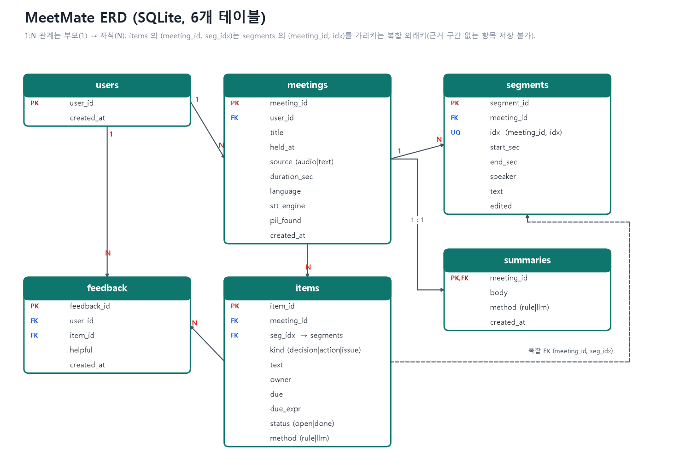

# MeetMate 데이터정의서

작성일 2026-11-26 · 작성자 반재영 · 버전 1.0 · DBMS: SQLite(Node.js 내장 `node:sqlite`) · 구현: `src/db.mjs`

## 1. ERD

- 1:N 관계는 부모 → 자식. `meetings`와 `summaries`는 1:1.
- `items`의 (`meeting_id`, `seg_idx`)는 `segments`의 (`meeting_id`, `idx`)를 가리키는 **복합 외래키**입니다. 근거 구간이 없는 결정·할 일은 저장 자체가 거부됩니다.
- 모든 사용자 데이터가 `users`에 ON DELETE CASCADE로 연결되어, 사용자 삭제 한 번으로 모든 기록이 지워집니다.

## 2. 테이블 목록

| 테이블 | 설명 | 주요 관계 |
|---|---|---|
| users | 익명 사용자(브라우저가 만든 난수 ID) | 1:N meetings, feedback |
| meetings | 회의 1건(제목·날짜·입력 방식·길이·받아쓰기 엔진) | 1:N segments, items / 1:1 summaries |
| segments | 받아쓴(또는 입력한) 발언 구간: 순번·시각·화자·문장 | N:1 meetings |
| summaries | 회의 요약(규칙 발췌 또는 AI 요약) | 1:1 meetings |
| items | 결정·할 일·미결 항목과 담당자·기한·완료 상태 | N:1 meetings, 복합 FK → segments |
| feedback | 항목별 도움됨/아님 평가 | N:1 users, items |

## 3. 테이블 정의

### 3.1 users
| 컬럼 | 타입 | 키 | NULL | 설명 |
|---|---|---|---|---|
| user_id | TEXT | PK | N | 익명 ID(`u-` + 난수 24자). 이름·연락처는 받지 않음 |
| created_at | TEXT | | N | 생성 시각(ISO 8601) |

### 3.2 meetings
| 컬럼 | 타입 | 키 | NULL | 설명 |
|---|---|---|---|---|
| meeting_id | INTEGER | PK(자동증가) | N | 회의 번호 |
| user_id | TEXT | FK→users | N | 소유자. 조회·수정 시 항상 함께 조건으로 사용 |
| title | TEXT | | N | 제목(최대 80자, 제어문자 제거) |
| held_at | TEXT | | N | 회의 날짜 YYYY-MM-DD. 기한 표현 계산의 기준일 |
| source | TEXT | CHECK | N | `audio` 또는 `text` |
| duration_sec | REAL | | Y | 음성 길이(초) |
| language | TEXT | | Y | 받아쓰기 언어(ko) |
| stt_engine | TEXT | | Y | 받아쓰기 엔진·모델(예: faster-whisper:small) |
| pii_found | TEXT | | N | 마스킹한 개인정보 종류 JSON 배열 |
| created_at | TEXT | | N | 생성 시각 |

### 3.3 segments
| 컬럼 | 타입 | 키 | NULL | 설명 |
|---|---|---|---|---|
| segment_id | INTEGER | PK | N | |
| meeting_id | INTEGER | FK→meetings, UNIQUE(meeting_id, idx) | N | 소속 회의(삭제 시 연쇄 삭제) |
| idx | INTEGER | | N | 회의 안의 구간 순번(0부터). 항목의 근거 번호 |
| start_sec / end_sec | REAL | | Y | 시작·끝 시각(음성·자막만) |
| speaker | TEXT | | Y | 화자(글 대본의 "이름:" 표기에서만 얻음. 음성은 화자 구분 불가라 NULL) |
| text | TEXT | | N | 마스킹된 문장 |
| edited | INTEGER | | N | 사용자가 교정했으면 1 |

### 3.4 summaries
| 컬럼 | 타입 | 키 | NULL | 설명 |
|---|---|---|---|---|
| meeting_id | INTEGER | PK, FK→meetings | N | 회의당 1건 |
| body | TEXT | | N | 요약 본문(건수 머리말 + 핵심 문장) |
| method | TEXT | CHECK | N | `rule`(원문 발췌) 또는 `llm`(검증 통과한 AI 요약) |
| created_at | TEXT | | N | |

### 3.5 items
| 컬럼 | 타입 | 키 | NULL | 설명 |
|---|---|---|---|---|
| item_id | INTEGER | PK | N | |
| meeting_id | INTEGER | FK→meetings | N | |
| seg_idx | INTEGER | 복합 FK→segments(meeting_id, idx) | N | **근거 구간 번호**(근거 없는 항목 저장 불가) |
| kind | TEXT | CHECK | N | `decision`(결정) · `action`(할 일) · `issue`(미결) |
| text | TEXT | | N | 항목 문장(규칙: 원문 문장 그대로, AI: 검증 통과 문장) |
| owner | TEXT | | Y | 담당자(참석자 이름과 대조된 값, 음성은 비어 있을 수 있음) |
| due | TEXT | | Y | 기한 YYYY-MM-DD(코드가 계산한 값만 저장) |
| due_expr | TEXT | | Y | 기한을 계산한 원래 표현(예: "다음 주 월요일까지") |
| status | TEXT | CHECK | N | `open` · `done` (기본 open) |
| method | TEXT | CHECK | N | `rule` · `llm` (어떻게 찾았는지, 화면에 구분 표시) |

### 3.6 feedback
| 컬럼 | 타입 | 키 | NULL | 설명 |
|---|---|---|---|---|
| feedback_id | INTEGER | PK | N | |
| user_id | TEXT | FK→users | N | |
| item_id | INTEGER | FK→items | N | 항목 삭제 시 연쇄 삭제 |
| helpful | INTEGER | CHECK(0,1) | N | 1=도움됨, 0=틀림 |
| created_at | TEXT | | N | |
| (제약) | | UNIQUE(user_id, item_id) | | 같은 항목을 다시 평가하면 덮어쓰기(UPSERT) |

## 4. 인덱스

| 인덱스 | 대상 | 목적 |
|---|---|---|
| ix_meetings_user | meetings(user_id, held_at DESC) | 내 회의 목록을 최신순으로 |
| ix_items_meeting | items(meeting_id, kind) | 회의별 종류별 항목 조회 |
| (자동) | segments UNIQUE(meeting_id, idx) | 복합 외래키의 부모 키 + 구간 순번 중복 방지 |

## 5. 데이터 관리 정책

| 항목 | 정책 |
|---|---|
| 음성 파일 | **저장하지 않음.** 받아쓰기가 끝나면(성공·실패 모두) 업로드 파일과 변환 파일을 즉시 삭제 |
| 개인정보 | 전화·이메일·주민번호·카드번호는 저장 전에 `[ ]`로 치환. 마스킹한 종류만 meetings.pii_found에 기록 |
| 식별 | 실명·이메일 없이 익명 ID만 사용. 로그인이 없으므로 ID를 아는 사람은 해당 기록에 접근 가능(한계: 다중 사용자 배포 시 인증 필요) |
| 삭제 | 회의 1건 삭제, 사용자 전체 삭제(`/api/forget`, confirm 필수). CASCADE로 구간·요약·항목·평가까지 삭제, 복구 불가 |
| 무결성 | 외래키 상시 검사, CHECK 제약(종류·상태·방식), 저장은 트랜잭션(회의·구간·요약·항목이 모두 저장되거나 모두 취소) |
| 백업 | `data/meetmate.db` 파일 복사. 회의 내용이 들어 있으므로 저장소(git)에는 올리지 않음(.gitignore) |
| 작업 큐 | 메모리에만 보관(DB 아님). 서버를 끄면 진행 중 작업은 사라짐 → 다시 업로드 |
