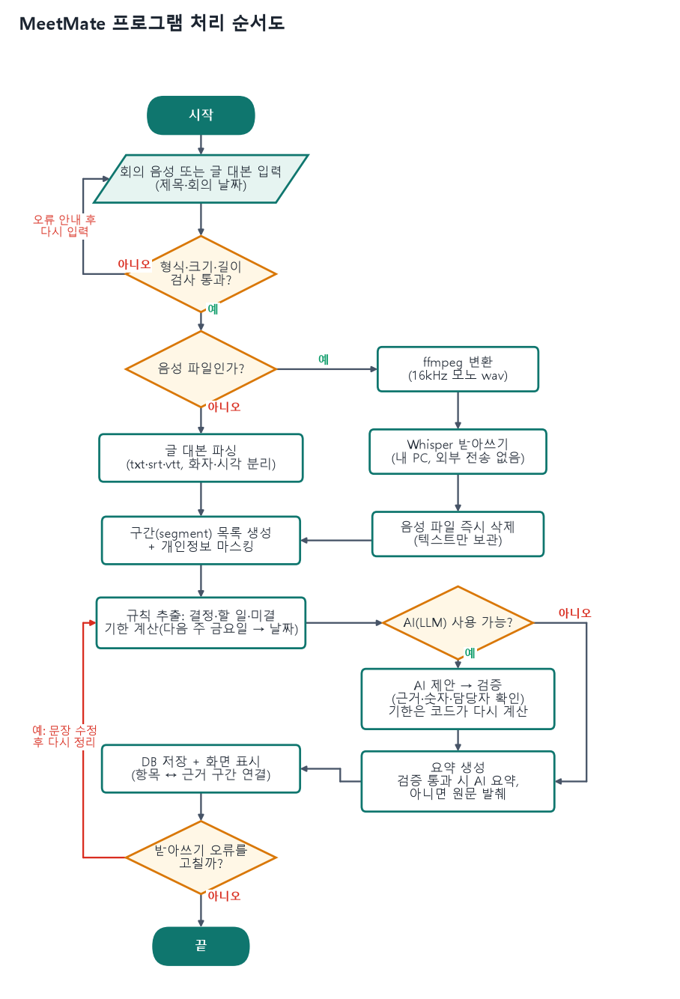

# MeetMate 요구사항 분석서

작성일 2026-11-26 · 작성자 반재영 · 버전 1.0

## 목차

1. 개요 · 2. 시스템 범위와 이해관계자 · 3. 현황 분석과 문제 정의 · 4. 사용자 요구 분석 · 5. 기능 요구사항 분석 · 6. 비기능 요구사항 분석 · 7. 제약 사항과 가정 · 8. 유스케이스(처리 순서도) · 9. 우선순위(MoSCoW) · 10. 추적성 · 11. 위험 분석

## 1. 개요

### 1.1 목적
회의 음성(또는 대본)에서 **결정 사항·할 일(담당자·기한)·미결 사항·요약**을 자동으로 정리하는 프로그램의 요구사항을 분석해, 이후 설계·구현·테스트의 기준을 정한다. 세부 명세는 「요구사항 명세서」에 있다.

### 1.2 시스템 개요
사용자가 회의 녹음 파일을 올리거나 직접 녹음하면, **내 PC에서** Whisper 모델이 받아쓰고, 규칙과 로컬 AI가 결정·할 일·미결을 찾아 근거 발언과 함께 보여 준다. 모든 항목은 원문 구간으로 되돌아가 확인할 수 있고, 받아쓰기가 틀리면 사용자가 고쳐서 다시 정리할 수 있다.

### 1.3 용어
| 용어 | 뜻 |
|---|---|
| 받아쓰기(STT) | 음성을 글자로 바꾸는 일. 이 프로젝트는 faster-whisper(Whisper small)를 로컬에서 사용 |
| 구간(segment) | 받아쓰기 결과 또는 대본의 한 발언 단위. 시작 시각·화자·문장을 가짐 |
| 항목(item) | 구간에서 뽑은 결정(decision)·할 일(action)·미결(issue) |
| 근거 구간 | 항목이 나온 원문 구간. 모든 항목은 반드시 하나를 가짐 |
| 환각 | AI가 대본에 없는 내용을 그럴듯하게 만들어 내는 것 |
| held-out | 규칙을 만든 뒤에 별도로 작성해, 규칙 개선에 쓰지 않은 평가 세트 |

## 2. 시스템 범위와 이해관계자

| 구분 | 내용 |
|---|---|
| 범위 안 | 음성·글 대본 입력, 로컬 받아쓰기, 결정·할 일·미결·요약 정리, 근거 확인, 교정·재정리, 할 일 관리, 회의 검색, 회의록 내보내기, 기록 삭제 |
| 범위 밖 | 화자 구분(누가 말했는지 자동 식별), 실시간 자막, 다국어, 일정·메신저 연동, 다중 사용자 로그인·권한, 클라우드 배포 |
| 이해관계자 | 사용자(소규모 팀·스터디·팀 프로젝트 구성원), 개발자(본인), 평가자(교육기관) |

## 3. 현황 분석과 문제 정의

1. **회의록 작성 부담**: 회의가 끝나면 누군가 기억에 의존해 정리하거나 아예 하지 않아, "그때 뭘 하기로 했지?"가 반복된다. 특히 팀 프로젝트에서는 의견 충돌·일정 변경이 잦은데 합의 내용이 남지 않는다(본인 팀 프로젝트 경험).
2. **기존 도구의 한계**: 클라우드 받아쓰기·요약 서비스는 회의 음성을 외부 서버로 보내므로 내부 회의·개인정보가 있는 회의에 쓰기 부담스럽고 비용이 든다.
3. **AI 요약의 신뢰 문제**: 생성형 AI 요약은 없는 결정·잘못된 날짜·틀린 담당자를 그럴듯하게 만들어 낸다. 회의록은 "누가 언제까지"가 틀리면 쓸모가 없다.
4. **받아쓰기 오류**: 음성 인식은 고유명사·전문용어를 자주 틀린다. 틀린 글자 위에서 만든 정리는 틀리므로, 사용자가 고칠 수 있어야 한다.

→ **문제 정의**: 음성을 밖으로 보내지 않고, 결정·할 일·미결을 **원문 근거와 함께** 정리하며, AI의 지어내기를 구조적으로 막고, 틀린 받아쓰기를 사용자가 고칠 수 있는 회의 정리 도구가 필요하다.

## 4. 사용자 요구 분석

| ID | 사용자 요구 | 관련 기능 |
|---|---|---|
| UN-01 | 녹음만 올리면 회의록이 나왔으면 좋겠다 | FR-01·02·05·08 |
| UN-02 | 누가 언제까지 뭘 하는지 한눈에 보고 싶다 | FR-05·06·11 |
| UN-03 | 정리가 맞는지 원문으로 확인하고 싶다 | FR-09 |
| UN-04 | 회의 내용이 외부로 나가면 안 된다 | FR-02·03, NFR-03 |
| UN-05 | 받아쓰기가 틀리면 고치고 싶다 | FR-10 |
| UN-06 | 지난 회의 내용을 찾고 싶다 | FR-12 |
| UN-07 | AI가 지어낸 내용은 걸러졌으면 좋겠다 | FR-07·08, NFR-06 |
| UN-08 | 끝난 일은 체크하고 남은 일만 보고 싶다 | FR-11 |

## 5. 기능 요구사항 분석

| 영역 | 분석 | 설계 결정 |
|---|---|---|
| 입력 | 음성은 형식·크기가 다양하고 악성 파일이 섞일 수 있음 | 파일 앞부분 바이트로 형식 판별, 크기·길이 제한, 서버가 만든 이름으로만 처리 |
| 받아쓰기 | 정확도·속도·개인정보를 동시에 만족해야 함 | 로컬 Whisper(small), 자식 프로세스 분리, 처리 후 음성 삭제, 느리므로 작업 큐 |
| 정리 | 한국어 회의 말투는 "~하기로 했습니다", "~까지 해 주세요" 같은 반복 패턴이 있으나 변형이 많음 | **규칙(정밀) + AI 제안(재현율 보완) + 검증(환각 차단)** 의 3단 구조 |
| 날짜 | "다음 주 금요일"은 회의 날짜 없이는 해석 불가, AI가 자주 틀림 | 코드로 계산(월~일 기준), 회의 날짜를 입력으로 받음, 마감 표지가 있을 때만 기한으로 인정 |
| 신뢰 | 틀린 정리가 더 위험 | 모든 항목에 근거 구간, AI 항목은 표시, 정밀도 우선(놓치는 것보다 틀린 것을 더 경계) |
| 교정 | 받아쓰기 오류는 불가피 | 구간 단위 교정 + 다시 정리, 완료 상태 유지 |

## 6. 비기능 요구사항 분석

| 분류 | 분석 |
|---|---|
| 개인정보 | 회의에는 이름·전화·이메일이 나온다 → 저장 전 마스킹, 음성 미보관, 127.0.0.1 바인딩 |
| 보안 | 파일 업로드(악성 파일), 남의 회의 접근(IDOR), 대본 속 스크립트(XSS), 프롬프트 주입, 명령 주입이 위험 → 각각 대응 테스트 |
| 성능 | 받아쓰기는 CPU에서 느림(실측해 문서화), 정리는 즉시 |
| 가용성 | AI·Whisper가 없어도 글 대본 정리는 항상 동작 |
| 정직성 | AI 결과와 한계(오인식·화자 구분 불가)를 화면에 명시 |

## 7. 제약 사항과 가정

- 개인 프로젝트(1인), 기획서 12/04·발표 12/30. PC는 GPU 성능이 낮아(GTX 1050) Whisper를 CPU로 실행.
- 외부 npm 패키지 없이 Node.js 24 내장 기능만 사용(설치·보안·라이선스 부담 감소). 받아쓰기만 Python(faster-whisper)·ffmpeg에 의존하며 선택 사항.
- 평가용 회의 음성은 실제 녹음이 없어 **Windows 한국어 음성(TTS)으로 만든 합성음**을 사용한다 → 실제 회의보다 쉬우므로 정확도는 상한선으로 해석.
- 사용자 평가는 지인 3~5명 대상(12/08~12/19 예정).

## 8. 유스케이스

| ID | 유스케이스 | 주 흐름 | 예외 |
|---|---|---|---|
| UC-01 | 음성으로 회의 정리 | 파일 선택 → 제목·날짜 입력 → 받아쓰기 시작 → 진행 단계 표시 → 결과 화면 | 415 형식 오류, 413 크기 초과, 받아쓰기 불가(글 대본 안내), 말 없음(422) |
| UC-02 | 글 대본으로 정리 | 붙여 넣기/샘플 → 정리 시작 → 결과 | 너무 짧음 400, 날짜 오류 400 |
| UC-03 | 근거 확인·교정 | 항목 클릭 → 근거 구간 이동 → ✎ 교정 → 다시 정리 | 빈 문장 400 |
| UC-04 | 할 일 관리 | 완료 체크·담당자·기한 수정 → 모아보기 | 잘못된 기한 400 |
| UC-05 | 검색 | 질의 입력 → 원문 발언 목록 | 결과 없음 안내 |
| UC-06 | 삭제 | 회의 삭제 / 내 기록 모두 삭제(확인창) | confirm 없으면 400 |

### 8.1 처리 순서도

## 9. 요구사항 우선순위 (MoSCoW)

| 구분 | 요구사항 |
|---|---|
| Must | FR-01·02·03·04·05·06·08·09·10·11·14·15, NFR-01·03·04·05·06 |
| Should | FR-07(AI 보조), 12(검색), 13(내보내기), NFR-02·07·08 |
| Could | FR-16(피드백), 17(브라우저 녹음) |
| Won't | 화자 자동 구분, 실시간 자막, 로그인·권한, 클라우드 배포 |

## 10. 추적성

| 사용자 요구 | 기능 요구 | 설계 요소 | 시험 |
|---|---|---|---|
| UN-01 | FR-01·02·05·08 | stt/transcript/extract | app·core 테스트 |
| UN-02 | FR-05·06·11 | extract, dates, db | 기한 계산·모아보기 테스트 |
| UN-03 | FR-09 | items 복합 FK, 화면 이동 | FK 거부 테스트 |
| UN-04 | FR-02·03 | 로컬 STT, 음성 삭제 | 임시 파일 테스트 |
| UN-05 | FR-10 | editSegment, reextract | 교정·재정리 테스트 |
| UN-06 | FR-12 | search.mjs | 검색 테스트 |
| UN-07 | FR-07·08 | validateLLMItem, 요약 검증 | 환각 차단 테스트 |
| UN-08 | FR-11 | updateItem, actions | 항목 수정 테스트 |

## 11. 위험 분석

| 위험 | 가능성 | 영향 | 대응 |
|---|---|---|---|
| 규칙이 변형 표현을 놓침 | 높음(held-out 실측) | 중 | AI 제안+검증, 교정·수동 수정, 평가 결과로 규칙 보강 |
| 받아쓰기 오인식으로 정리가 틀림 | 높음 | 중 | 구간 교정·다시 정리, 화면 안내 |
| AI 환각 | 중 | 높음 | 검증 7종, 표시, 규칙 우선 |
| 화자 구분 불가 → 담당자 공백 | 높음(음성) | 중 | 요청형은 이름 해석, 나머지는 사용자가 지정 |
| 실제 회의 음성이 합성음보다 훨씬 어려움 | 높음 | 높음 | 정확도를 상한선으로 명시, 12월 실제 녹음 평가 |
| 로그인 없음 → ID를 알면 접근 | 낮음(로컬 전용) | 중 | 127.0.0.1 바인딩, 한계로 명시 |
