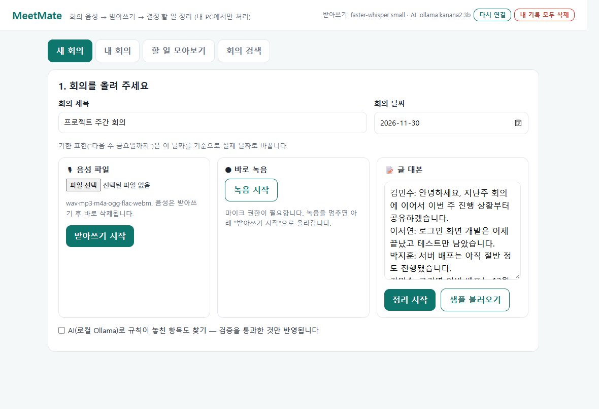
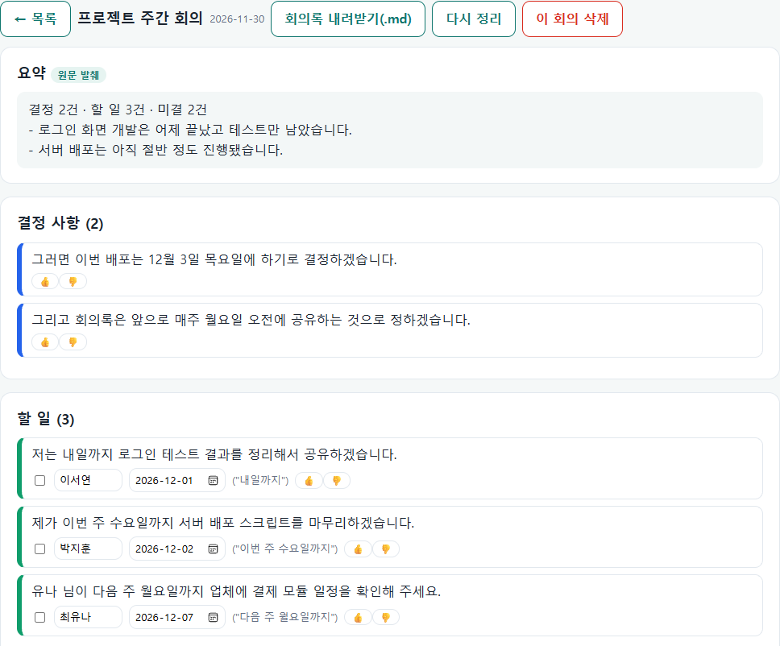
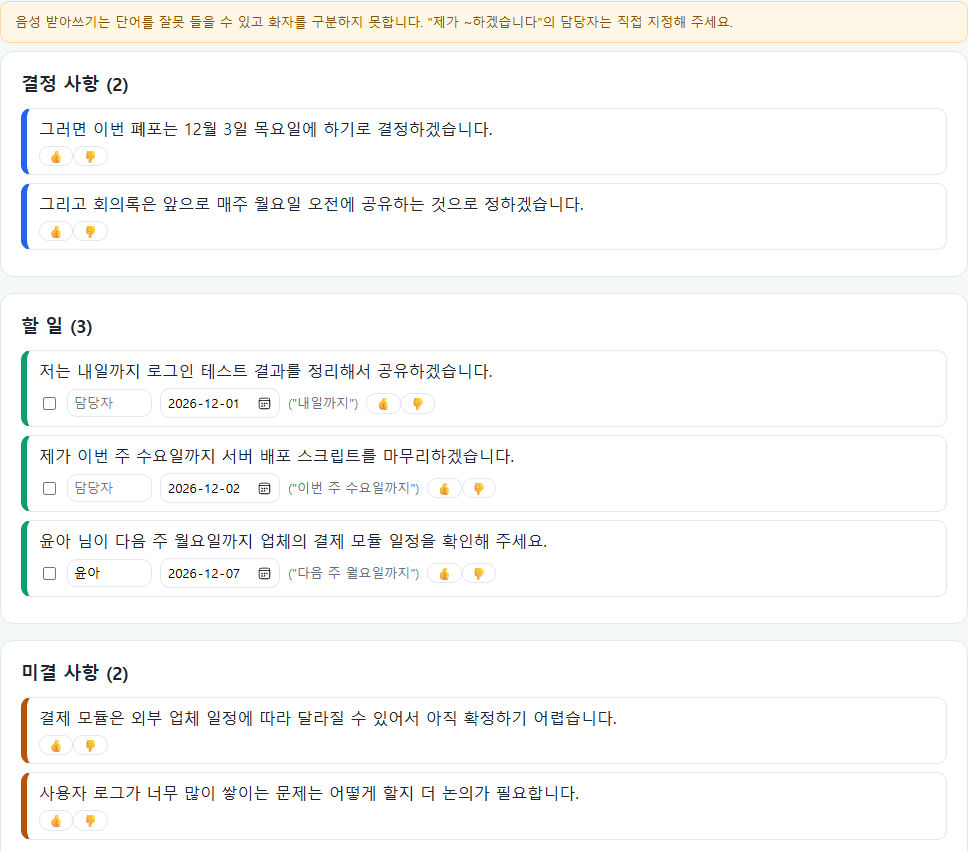
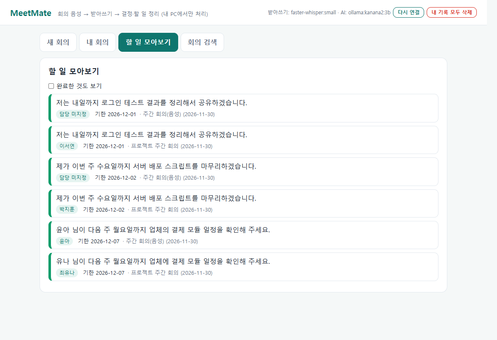
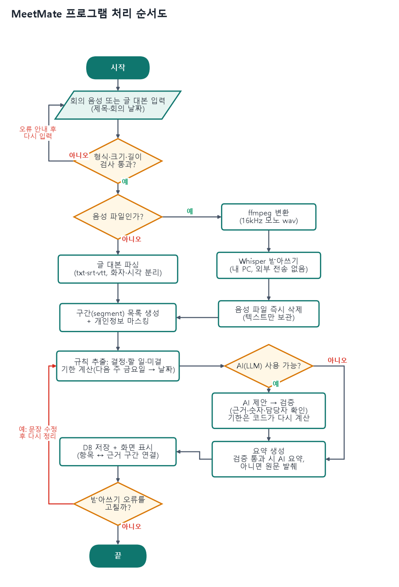
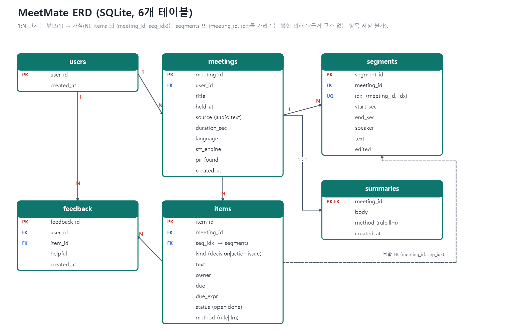

# 포트폴리오 — MeetMate

## 한 줄 소개
회의 녹음을 **내 PC에서** 받아쓰고, 결정 사항·할 일(담당자·기한)·미결 사항을 **원문 근거와 함께** 정리하며, AI가 지어낸 항목은 검증으로 걸러내는 회의 정리 시스템.

## 프로젝트 정보
| 항목 | 내용 |
|---|---|
| 작성자 | 반재영 (개인 프로젝트, 기획·설계·구현·테스트·문서 전 과정) |
| 기간 | 2026.11.26 ~ 12.30 (기획서 12/04, 발표 12/30) |
| 기술 | Node.js 24, SQLite(node:sqlite), faster-whisper(Whisper small), ffmpeg, Ollama(kanana2:3b, 선택), 바닐라 JS, 외부 npm 패키지 0개 |
| 코드 | `projects/MeetMate` (소스 약 1,500줄 + 테스트 55개, 모든 파일에 무엇을·왜 주석) |

## 문제와 해결
- **문제**: 팀 프로젝트에서 회의 후 합의 내용이 남지 않아 역할과 일정이 흐려졌다. 클라우드 요약 서비스는 음성을 외부로 보내야 하고, 생성형 AI는 틀린 날짜·담당자를 그럴듯하게 만든다.
- **해결**: 로컬 Whisper 받아쓰기 → 규칙(정밀) + AI 제안(재현율) + 검증(환각 차단)으로 결정·할 일·미결 정리 → 모든 항목에 근거 구간 연결 → 틀린 받아쓰기는 사용자가 고치고 다시 정리.

## 핵심 성과
- 음성이 PC 밖으로 나가지 않고, 받아쓰기 직후 음성 파일 삭제(성공·실패 모든 경로를 테스트로 확인).
- **근거 없는 항목은 DB에 저장 불가**: `items(meeting_id, seg_idx)`가 `segments`를 가리키는 복합 외래키.
- 기한("다음 주 금요일까지")은 AI가 아니라 **코드가 날짜로 계산**(시간대 오류 없는 UTC 계산, 마감 표지가 있을 때만 기한 인정).
- 자동 테스트 55개, 핵심 로직 10곳을 망가뜨려 테스트가 잡는지 확인(8곳 검출, 2곳은 동작 차이 없는 변경).
- **정직한 평가**: 개발용 100% → 새 말투 세트 재현율 54%임을 확인하고 세트를 분리. 최종 새 세트(정답 31개): 규칙 정밀도 100%·재현율 71.0%, 규칙+AI 정밀도 88.9%·재현율 77.4%. 받아쓰기(합성음) 글자 오류율 1.7%, 속도 음성의 0.25배.

## 화면
| 입력 | 결과(결정·할 일·미결) |
|---|---|
|  |  |

| 실제 음성 결과(오인식·담당자 공백이 그대로 드러남) | 할 일 모아보기 |
|---|---|
|  |  |

## 아키텍처·데이터

## 내가 한 기술적 선택과 이유
| 선택 | 이유 |
|---|---|
| 로컬 Whisper + 자식 프로세스 | 음성 보호·비용 0, 실패·시간 초과가 서버에 영향 없음 |
| 규칙 + AI + 검증의 3단 구조 | 규칙은 원문 문장 그대로라 지어낼 수 없고, AI는 재현율을 보완하되 검증을 통과한 것만 채택 |
| 날짜는 코드로 계산 | AI는 요일·월말 계산을 자주 틀리고, 틀려도 그럴듯함 |
| 작업 큐(한 번에 하나) | Whisper가 CPU를 거의 다 쓰므로 동시 실행은 모두를 느리게 함 |
| 파일 형식은 내용으로 판별, 셸 없이 실행 | 이름만 바꾼 악성 파일·명령 주입 차단 |
| 세트 분리 평가(개발용/held-out1/held-out2) | 같은 데이터로 만들고 재면 과대평가 → 실제로 100%→54% 하락 확인 |

## 측정으로 발견해 고친 것
1. 규칙이 새 말투를 절반 놓침 → 일반적인 한국어 단서로 보강(새 세트로 재검증).
2. AI가 잡담을 할 일로 분류해도 근거 일치 검증을 통과(정밀도 100%→66%) → **말투 단서 관문** 추가, 그래도 이득이 분명하지 않아 AI 보조를 기본 꺼짐으로.
3. "주시면 좋겠어요"를 약속으로 오인해 담당자가 틀림 → 평가 후 발견·수정·회귀 테스트.
4. 한 발언의 두 문장이 할 일 2건으로 중복 → 기한 있는 쪽으로 합침.

## 배운 점과 한계
- "근거가 있다"와 "분류가 맞다"는 다른 문제이고, AI 출력은 **측정해 보기 전에는** 좋아졌는지 알 수 없다.
- 평가 데이터는 가상 대본·합성음이라 정확도는 상한선에 가깝다. 화자 구분이 없어 음성의 담당자는 사용자가 지정해야 하고, 로그인이 없어 127.0.0.1에서만 연다.
- 12월: 실제 녹음·사용자 평가, 더 큰 모델·Claude·ChatGPT 재측정.

## 산출물
기획서 · 요구사항 분석서 · 요구사항 명세서 · 데이터정의서(ERD) · 순서도 2종 · 개발일정표 · 테스트 결과서 · 발표자료(PPTX·PDF) · 소스 코드 · 자동 테스트
